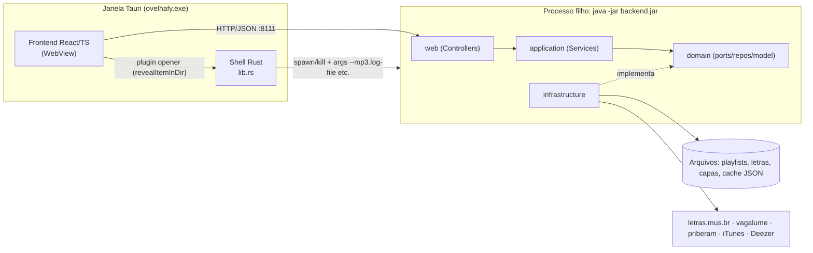

# Especificação Técnica — ovelhafy (Arquitetura Macro)

## Resumo Executivo

O ovelhafy é composto por três camadas executadas na máquina do usuário: (1) um **frontend** React 18 + TypeScript renderizado na WebView de uma janela **Tauri v2**; (2) um **shell nativo Rust** mínimo, que apenas inicia/encerra o backend e expõe o plugin `opener`; (3) um **backend Spring Boot 3.3.5 (Java 21)** que expõe uma API REST em `localhost:8111`, toca o áudio no próprio processo Java (JLayer), lê/grava tags ID3 (mp3agic) e faz scraping/consultas externas (Jsoup).

Não há banco de dados nem IPC próprio do Tauri: a comunicação de negócio é HTTP, e o estado de reprodução é obtido por polling de 1 s. A persistência é em arquivos (playlists `.txt`, letras `.txt`, capas, cache JSON de metadados) e `localStorage` (preferências). O empacotamento embute `backend.jar` e um JRE reduzido (`jlink`) dentro do instalador Tauri (MSI/NSIS), orquestrado por `scripts/build-release.ps1`.

## Arquitetura do Sistema

### Visão Geral dos Componentes



- **Frontend** (`frontend/src`): `app/` (providers `AppContext`, `LibraryContext`, `PlayerContext`; `App.tsx` faz polling e restauração da última pasta), `widgets/` (Toolbar, LeftPanel que alterna Letra/Coleção/Configurações, RightPanel com Player + Playlist), `features/*` e `shared/*`.
- **Shell nativo** (`frontend/src-tauri/src/lib.rs`): `spawn_backend` resolve `<resource_dir>/resources/jre/bin/java.exe` e `backend.jar`; se ausentes (modo dev) apenas loga "backend resources not found". `kill_backend` é chamado em `RunEvent::Exit`.
- **Backend** (`backend/src/main/java/com/ovelha/fy`): módulos `player` (`controls`, `music`, `playlist`, `domain`), `lyrics`, `dictionary`, `shared`. Regra de dependência `web → application → domain ← infrastructure`.
- **Fluxo de dados típico (tocar uma música):** clique na lista → `usePlayback.playFile` → `POST /play` (corpo texto = caminho) → `PlayerService.play` → `JLayerPlayerEngine.play` (analisa frames, lê tags, inicia virtual thread de áudio) → polling `GET /playing` atualiza posição/duração/tags a cada 1 s → ao fim da faixa, o polling detecta `stopped` e dispara `play` da próxima (autoplay, no frontend).

## Design de Implementação

### Interfaces Principais

Portas e repositórios de domínio (backend):

```java
public interface PlayerEngine {            // player/domain/port
    void play(String path) throws IOException;  void play(String path, long startMs) throws IOException;
    void pause(); void resume(); void seekTo(long ms); void stop();
    boolean isPlaying(); boolean isPaused();
    String getCurrentFilePath(); long getElapsedMillis(); long getTotalMillis();
    Map<String,String> getId3Tags();
}
public interface Id3Codec { MusicFile read(String path); MusicFile update(String path, Map<String,String> tags); }
public interface AlbumCoverSearcher { CoverImage findCover(String query) throws IOException; }
public interface MusicScanner { List<MusicFile> scanFolder(String folder) throws IOException; }
public interface LyricsScraper { String fetch(String artist, String title) throws IOException; }
public interface LyricsSource { String getName(); int getPriority(); boolean isEnabled(); String getUserAgent();
    String findPage(String artist, String title) throws IOException; String extractLyrics(Document page); }
public interface DictionarySource { String language(); String sourceName(); DictionaryLookupResult lookup(String word); }
public interface PlaylistRepository { List<String> list(); List<String> load(String n); void save(Playlist p); void delete(String n); void rename(String a, String b); }
public interface LyricRepository { Optional<Lyric> find(String musicPath); void save(Lyric l, MusicFile m); boolean exists(String p); void delete(String p); }
public interface MetadataCacheRepository { Map<String,String> get(String p); void put(String p, Map<String,String> t); void putAll(Map<String,Map<String,String>> m); String location(); }
```

Montagem por configuração Spring: `Id3CodecConfig` (`CachedId3Codec` decorando `Id3MagicCodec`), `CoverSearcherConfig` (`CompositeCoverSearcher[iTunes, Deezer]`), `LyricsConfig` (lista de `LyricsSource` a partir de `LyricsProperties`).

Frontend: módulos `shared/api/*` expõem funções tipadas (`playbackApi.play/pause/resume/stop/seek/getStatus`, `playlistApi.*`, `id3Api.bulkId3/updateId3`, `lyricsApi.*`, `coverApi.*`, `dictionaryApi.lookup`, `systemApi.getInfo`).

### Modelos de Dados

- **`MusicFile`** `{path, Metadata(title, artist, album, year, genre, track, disc, durationMs, bitrateKbps)}`; serializado ao frontend como mapa de tags (`toTagMap`): chaves `title, artist, album, year, genre, track, disc, duration_ms, kbps` (somente as não vazias).
- **`Id3Tags` (frontend)**: `title?, artist?, album?, year?, genre?, track?, disc?, duration_ms?, kbps?, error?` — todos `string`.
- **`Playlist`** `{name, songPaths}`; **`Lyric`** `{musicPath, text}`; **`CoverImage`** `{bytes, contentType}`; **`Artist`/`Album`** (existem no domínio; não usados pelos controllers `[PENDENTE / AMBÍGUO NO CÓDIGO]`); **`DictionaryLookupResult`** `{word, source, language, meanings}`; **`Settings`** `{playbackMode, showCover}` (não utilizado em runtime `[PENDENTE / AMBÍGUO NO CÓDIGO]`).
- **Estado do frontend:** `PlayerState {currentFile, status 'playing'|'paused'|'stopped', position, duration, playbackMode 'continuous'|'shuffle'|'repeat', showCover, intentionalStop, playHistory[≤100]}`; `LibraryState {libraryFiles, playlistFiles, playlists, id3Cache Map<path, Id3Tags>, id3Loading/Loaded/Total}`; `AppState {view 'lyrics'|'settings'|'collection', showInfo, theme}`.
- **Persistência:** ver tabela abaixo. Não há esquema de banco.

| Dado | Local | Formato | Responsável |
|---|---|---|---|
| Playlists virtuais | `~/.mp3-player/playlists/<nome sanitizado>.txt` | um caminho absoluto por linha, UTF-8 | `FilePlaylistRepository` |
| Cache de tags | `<dir do mp3.log-file>/music-cache.json` (app instalado) ou `~/.mp3-player/music-cache.json` (dev) | JSON `{ caminho: { tag: valor, "_lastModified": ms } }`, gravação atômica via `.tmp` + move | `FileMetadataCacheRepository` |
| Letras | `<pasta do mp3>/<Artista> - <Título>.txt` (ou nome do arquivo) | texto UTF-8 | `FileLyricRepository` |
| Capas | `<pasta do mp3>/cover.<jpg\|png\|webp\|gif>` | binário | `CoverService` |
| Log do backend | `<app_log_dir do Tauri>/backend.log` (stdout/stderr do processo) | texto | shell Rust |
| Preferências | `localStorage`: `mp3_folder`, `mp3_theme`, `lyrics_font_size` | strings | frontend |

### Endpoints de API

Base `http://localhost:8111`. CORS `*`. Sem autenticação. Erros: `400` com corpo texto; `404` quando indicado.

| Método e caminho | Descrição | Requisição → Resposta |
|---|---|---|
| `POST /play` | Toca arquivo | corpo `text/plain` = caminho → `200 "Playing: …"` / `400 "Error: …"` |
| `POST /pause` · `/resume` | Pausa/retoma | sem corpo → `200 "Paused"`/`"Resumed"`; `400` se nada tocando/estado inválido |
| `POST /stop` | Para | `200 "Stopped"` |
| `POST /seek` | Salta para posição | JSON `{position: ms}` → `200 "Seeked to N"` / `400` |
| `GET /playing` | Estado | → `{status, file, position, duration, id3}` (`status:"stopped"` retorna só `status`,`file:""`) |
| `GET /playlist?path=` | Escaneia pasta (recursivo, `.mp3`) | → `string[]` / `400` |
| `GET /playlists` | Lista playlists virtuais | → `string[]` |
| `GET /playlist/{name}` | Carrega playlist virtual | → `string[]` (vazio se não existe) |
| `POST /playlist` | Cria/atualiza | `{name, paths}` → `200 "Saved"` / `400` |
| `DELETE /playlist/{name}` | Exclui | `200 "Deleted"` |
| `POST /playlist/rename` | Renomeia | `{oldName,newName}` → `200 "Renamed"` / `404` |
| `GET /id3?path=` | Tags de um arquivo | → mapa de tags |
| `POST /id3/bulk?refresh=false` | Tags em lote | `string[]` → `{ caminho: mapa }` |
| `POST /id3/update` | Grava tags | `{path, tags}` → mapa atualizado / `400` |
| `GET /cover?path=` | Capa existente na pasta | → imagem / `404` |
| `POST /cover/download` | Baixa capa | `{path}` → `200` caminho salvo / `400` |
| `GET /lyrics/cached?path=` · `GET /lyrics?path=` | Letra em cache / busca | → texto / `404` (cached) |
| `POST /lyrics` · `DELETE /lyrics?path=` | Salva / remove | `{path,text}` → `200` |
| `POST /dictionary/lookup` | Significado | `{word, language}` → `DictionaryLookupResult` / `400` / `404` |
| `GET /dictionary/languages` | Idiomas | → `["pt"]` |
| `GET /info` | Info do sistema | → `{logFile, cacheFile, backendPort, frontendPort}` |

Detalhamento por funcionalidade nas atividades `ofy-001` a `ofy-016`.

## Pontos de Integração

- **letras.mus.br** e **vagalume.com.br** (scraping HTML, Jsoup): `User-Agent` de navegador, cabeçalhos `Accept*`/`Sec-Fetch-*`, timeouts em `application.properties` (`mp3.lyrics.*`). Falhas viram `null` e a próxima fonte é tentada.
- **dicionario.priberam.org** (scraping; seletor `.dp-definicao` / `py-4 dp-definicao-linha`), timeout fixo de 10 s.
- **iTunes Search API** (`artworkUrl100` → `600x600bb`) e **Deezer API** (`cover_xl`, fallback `cover_medium`), via `AbstractCoverSearcher` + `CoverDownloader`.
- **Tauri**: plugin `opener` (permissão `opener:default`) para `revealItemInDir`.
- **Autenticação:** nenhuma. **Tratamento de erros:** exceções capturadas nos adapters/controllers, mensagens em texto; nenhuma retentativa automática (exceto restauração de pasta no frontend).

## Abordagem de Testes

### Testes Unitários

- Backend (`backend/src/test/java/com/ovelha/fy/**`, 35 classes de teste): domínio (`LyricTest`, `PlaylistTest`, `AlbumTest`, `ArtistTest`, `CoverImageTest`, `MusicFileTest`, `SettingsTest`, `DictionaryLookupResultTest`), serviços (`PlayerServiceTest`, `Id3ServiceTest`, `CoverServiceTest`, `PlaylistServiceTest`, `LyricsServiceTest`, `DictionaryLookupServiceTest`), infraestrutura (`JLayerPlayerEngineTest`, `CachedId3CodecTest`, `Id3MagicCodecTest`, `FileMetadataCacheRepositoryTest`, `FilePlaylistRepositoryTest`, `FileMusicFileScannerTest`, `FileLyricRepositoryTest`, searchers/scrapers) e controllers (`*ControllerTest`, `CorsConfigTest`).
- Frontend (Vitest): `navigation`, `usePlayback`, `usePlaybackPolling`, `Player`, `CoverArt`, `useColumnResize`, `usePlaylistTooltip`, `ColumnHeader`, `Playlist`, `PlaylistTooltip`, `SearchBar`. Mock do módulo de API/`fetch`.

### Testes de Integração

- `Mp3PlayerApplicationTests`: sobe o contexto Spring e valida injeção de beans. Não há testes E2E nem de integração com sites externos reais.

## Sequenciamento de Desenvolvimento

### Ordem de Construção

Ordem real inferida do histórico (`CHANGELOG.md`): (1) player + backend REST (v0.9–1.0); (2) empacotamento desktop com JRE embarcado; (3) playlists virtuais, letras, capas; (4) cache de metadados e virtual threads, temas (1.2); (5) busca avançada e padrões de projeto (1.3); (6) dicionário, edição em massa, menus de contexto (1.4); (7) refatoração Feature-Sliced Design e migração para `com.ovelha.fy` (1.5); (8) nova fonte de letras, correções de autoplay/seek, "adicionar à playlist" (1.5.x–1.6.0).

### Dependências Técnicas

- Para desenvolvimento: JDK 21, Maven 3.8+, Node 18+, Rust toolchain, WebView2 (Windows). Para release: `jlink` no PATH, `git`, PowerShell.
- Internet para letras, capas e dicionário.

## Monitoramento e Observabilidade

- Não há métricas Prometheus nem dashboards Grafana `[PENDENTE / AMBÍGUO NO CÓDIGO]`.
- Logs: SLF4J no backend (INFO para operações, WARN/ERROR para falhas) com prefixos `[Player]`, `[ID3]`, `[Cache]`, `[Capa]`, `[Lyrics]`, `[Scraper]`, `[Dicionário]`, `[Playlist]`; no app instalado, saída redirecionada para `<app_log_dir>/backend.log`; o caminho é exibido em Configurações via `GET /info`. Frontend usa `console.log` das tags ao trocar de faixa.
- Em dev não há arquivo de log: `mp3.log-file` vazio → `logFile` retorna string vazia e o cache vai para `~/.mp3-player/`.

## Considerações Técnicas

### Decisões Principais

- **Backend Java separado em vez de comandos Tauri:** reaproveita JLayer/mp3agic/Jsoup e a arquitetura em camadas; custo: processo extra e JRE embarcado (instalador grande — `backend.jar` ≈ 22 MB e JRE ≈ 40 MB em `lib/modules`).
- **Sem banco de dados:** simplicidade de instalação; trade-off: consultas/estatísticas limitadas e cache JSON único regravado por completo a cada `put` (ver riscos).
- **Polling em vez de eventos:** simples; trade-off: latência de até 1 s e tráfego contínuo.
- **Lógica de navegação/busca no frontend:** evita endpoints adicionais; trade-off: regras duplicadas se houver outro cliente.
- **Padrões:** Ports & Adapters, Decorator (cache), Template Method + Composite/Strategy (fontes externas).

### Riscos Conhecidos

- **Exposição de rede/segurança:** `server.address=0.0.0.0`, CORS `*`, sem autenticação e com caminhos arbitrários (ver `Rules.md` §6).
- **Scraping frágil:** seletores HTML de terceiros podem quebrar; `CompositeLyricsScraper` usa referrer e timeout fixos, ignorando a configuração por fonte `[PENDENTE / AMBÍGUO NO CÓDIGO]`.
- **Edição de ID3 destrutiva:** `Id3MagicCodec.update` cria nova tag ID3v2.4 só com os campos enviados e remove ID3v1; campos ausentes e frames não tratados (ex.: imagem APIC) são perdidos.
- **Cache:** `FileMetadataCacheRepository.put` regrava todo o JSON a cada arquivo lido; `Id3Service.getBulk` devolve entradas do cache sem checar `_lastModified` e o mapa devolvido inclui a chave interna `_lastModified`; `refresh=true` ainda passa por `CachedId3Codec.read`, que reutiliza cache não obsoleto.
- **Reprodução:** `JLayerPlayerEngine` percorre todo o arquivo para contar frames a cada `play`/`seek` (custo O(arquivo)); `seek` reinicia a reprodução na posição.
- **Concorrência:** polling + `intentionalStop` + `advancingRef` no frontend para evitar avanço duplo; comportamento sob cliques rápidos não é coberto por teste E2E.
- **Versionamento:** `pom.xml` fica em `1.0.0`; versões do app são atualizadas só em `package.json`, `tauri.conf.json`, `Cargo.toml` e `App.tsx`.

### Conformidade com Padrões

Não existe a pasta `.cursor/rules` neste repositório (referenciada pelo template). Padrões aplicáveis:

- `docs/sdd/Rules.md` (regras gerais deste projeto).
- `.opencode/skills/backend-arch/SKILL.md` (Clean Architecture/DDD, regra de dependência, logging, testes).
- `.opencode/skills/backend-dev/SKILL.md` (SOLID, AAA, DI, Javadoc).
- `.opencode/skills/frontend-style/SKILL.md` (visual monocromático, Feature-Sliced, TS strict).
- `.opencode/skills/build-release/SKILL.md` (fluxo de release).
- `docs/architecture.md` (diagramas do backend; parcialmente desatualizado — não cita Vagalume).

### Arquivos relevantes

- Backend: `backend/pom.xml`, `backend/src/main/resources/application.properties`, `backend/src/main/java/com/ovelha/fy/Mp3PlayerApplication.java`, `shared/config/*`, `player/**`, `lyrics/**`, `dictionary/**`.
- Frontend: `frontend/package.json`, `vite.config.js`, `vitest.config.ts`, `tsconfig.json`, `src/main.tsx`, `src/app/**`, `src/widgets/**`, `src/features/**`, `src/shared/**`.
- Nativo: `frontend/src-tauri/Cargo.toml`, `tauri.conf.json`, `capabilities/default.json`, `src/lib.rs`, `src/main.rs`, `build.rs`.
- Build: `scripts/build-release.ps1`, `CHANGELOG.md`, `.gitignore`.
- Documentação: `README.md`, `docs/architecture.md`, `docs/sdd/**`.

## Build e Empacotamento

- **Dev:** `mvn spring-boot:run` (8111) + `npm run dev` (Tauri; `beforeDevCommand: npm run dev:vite`, `devUrl http://localhost:8112`). No modo dev o shell não inicia o backend (sem `resources/`).
- **Release (`scripts/build-release.ps1`):** lê a última tag git → classifica commits por palavras-chave (Adicionado/Alterado/Corrigido/Refatorado/Removido) → calcula versão (`-Version`, `-Major`, `-Minor` ou `added>0`⇒minor, senão patch) → atualiza 4 arquivos de versão e `CHANGELOG.md` → `mvn -q package -DskipTests` → `jlink` (25 módulos, `--strip-debug --compress=2`) para `src-tauri/resources/jre` → copia o fat JAR como `resources/backend.jar` → `npm run build` (`tauri build`, bundle `targets: all`, recursos `resources/backend.jar` e `resources/jre/**/*`) → `git add -A`, commit `release: vX.Y.Z` e tag. Instaladores em `frontend/src-tauri/target/release/bundle/{msi,nsis}/`. `-DryRun` apenas simula.
